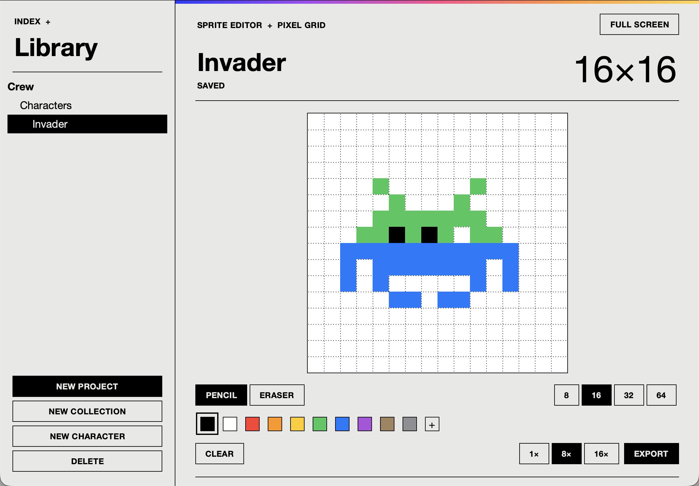

# Sprites

A small pixel-art editor. Draw characters on a grid, organize them as project › collection › character, export to PNG, GIF or SVG.



## Run

Needs [uv](https://docs.astral.sh/uv/). It installs a Python with Tk for you.

```sh
uv run main.py
```

## Use

1. **New project**, then **New collection**, then **New character** (a project with no collection gets one automatically).
2. Left click draws, right click erases. Double-click a character in the sidebar to open it. Changes save on their own.
3. Switch the grid between 8, 16, 32 and 64. The picture keeps its position and shape.
4. **Export** picks the format from the file extension. `F11` or **Full screen** toggles full screen.

Characters live in `library/` as JSON files.

## Layout

```
main.py            entry point
sprites/app.py     window and editing logic
sprites/widgets.py buttons, dialogs, rules
sprites/model.py   grid, resampling, save/load (no Tk)
sprites/export.py  PNG / GIF / SVG
sprites/library.py library paths and name checks
sprites/theme.py   colors, sizes, fonts
tests/             uv run python -m unittest
```
